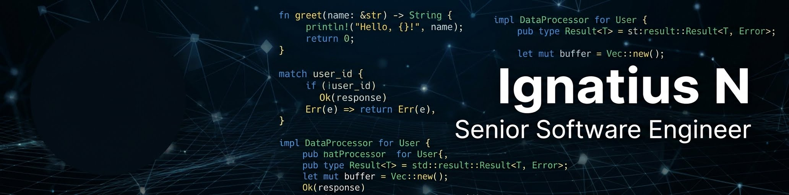

# Hi, I'm Ignatius Nyongesa! 
---
#### Full-Stack Software Engineer | PHP & Laravel Specialist | Backend Architecture | DevOps Enthusiast
---
I build reliable, scalable web applications and backend systems that solve real-world business problems.

I'm a full-stack software engineer with 7+ years of experience in software development, specialising in PHP, Laravel, and modern JavaScript ecosystems. I enjoy working across the entire software development lifecycle; from system architecture and database design to API development, frontend engineering, infrastructure, deployment, and optimisation.

Currently, I'm working as a Full-Stack Developer at Aquantuo, building and improving logistics and shipping technology.

My engineering interests extend beyond application development into distributed systems, infrastructure automation, developer tooling, and high-performance backend technologies.

---
###### 🚀 What I Do

Backend Engineering: Building maintainable, scalable applications and APIs using PHP and Laravel.

System Architecture: Designing modular applications, multi-tenant systems, database structures and business logic.

API Development & Integrations: RESTful APIs, third-party integrations, webhooks, authentication and asynchronous processing.

Frontend Engineering: Building responsive, interactive applications using Vue.js, Nuxt, JavaScript and modern CSS frameworks.

Infrastructure & DevOps: Linux server administration, Docker, containerised deployments, reverse proxies and application infrastructure.

Database Engineering: Relational database design, query optimisation, data modelling and caching strategies.

---
###### 🛠️ Technology Stack
Backend & Application Development

Frontend Development

Databases, Caching & Messaging

Infrastructure & Development Tools

---
###### 🏗️ Engineering Interests & Areas of Focus

I'm particularly interested in engineering systems that are modular, maintainable, performant, and capable of scaling with business requirements.

Some areas I'm actively exploring and building around include:

SaaS Architecture: Multi-tenancy, multi-database architectures, domain-based tenancy, and modular application design.

Distributed Systems: Asynchronous processing, message queues, event-driven architecture, and service communication.

Rust Ecosystem: Exploring Rust for high-performance backend services, particularly with Actix Web and asynchronous systems.

Desktop Applications: Exploring Tauri for lightweight, cross-platform desktop applications.

AI & Automation: Local LLMs, retrieval-augmented generation (RAG), workflow automation, and intelligent business integrations.

Infrastructure Engineering: Self-hosted infrastructure, container orchestration, server security, and deployment automation.

I enjoy understanding how things work under the hood rather than simply relying on abstractions.

---
###### 💼 Professional Experience

Full-Stack Developer - Aquantuo

Working on logistics and shipping technology, contributing across backend services, frontend applications, integrations, and business-critical application workflows.

Previous experience includes:

Building e-commerce platforms and multi-store management applications.

Developing administrative dashboards and business management systems.

Modernising legacy applications and migrating systems to Laravel.

Building solutions across e-commerce, education, property management, construction and other business domains.

Linux server administration and supporting production application environments.

---
###### 🌱 Currently Exploring

Rust, Actix Web, and asynchronous backend architecture.

Tauri and cross-platform desktop development.

AI-powered applications, local LLMs, and RAG.

Advanced Laravel architecture and performance optimisation.

Distributed systems and event-driven application design.

---
###### 🤝 Let's Connect & Collaborate

I'm always interested in connecting with engineers, founders and teams building meaningful software.

I'm particularly interested in:
- Backend engineering and Laravel opportunities.
- SaaS and multi-tenant application development.
- Open-source collaboration.
- Developer tooling and infrastructure.
- AI-powered applications and automation.

Have an interesting engineering problem or project? Let's talk.
📧 Email: [Say Hi](mailto:reach-ignatius@bytedots.com)

🌐 Website: [Bytedots](https://bytedots.com)

💼 LinkedIn: [Ignatius Nyongesa](https://www.linkedin.com/in/ignatius-nyongesa-17a331223/)

💻 GitHub: [Ignatius N](https://ignatius-n.com)

📊 GitHub Activity

  
  

  

  <i>Building software, understanding systems, and getting better at engineering every day.</i>

I'm Ignatius Nyongesa and I'm a software developer/DevOps engineer. I have over 6 years of experience in software development and over 2 years working as a full time employee. I have worked as a web app developer and tester. My stack usually comprises of:

- PHP (Laravel)
- JavaScript (Vanilla, jQuery, AlpineJS,VueJS, NuxtJS)
- DBMS (MySQL, MongoDB)
- Caching (Redis)
- CSS (Vanilla, bootstrap 4 ~ 5)

Have have done some little of Linux Server Administration for several months in a fast-paced environment. Besides I'm very comfortable working with Linux and the terminal.

I have developed a number of projects in various fields like :
- Building and Construction
- Property management
- Ecommerce
- Legal systems
- Crypto industry
- E learning
and so much more

## 🔧 Technologies & Tools

Skills: Laravel / VueJS / MySQL / MongoDB / Bootstrap 4 ~ 5 / Docker / Redis

- 🔭 I’m currently working on https://bytedots.com 
- 🌱 I’m currently learning **K8s, ML/DL** 
- 👯 I’m looking to collaborate on **some AI & Crypto projects** 
- 🤔 I’m looking for help with **graphics design** and **digital marketing** 
- 💬 Ask me about **Laravel, Docker....** 
- 📫 How to reach me: reach-ignatius@bytedots.com 
- 😄 Pronouns: **Ignatius Origin and Meaning** The name Ignatius is a boy's name of Latin origin meaning **"fiery"**. ... 
- ⚡ Fun fact: You look so much better when you smile 

                

  

  

  

  

  
